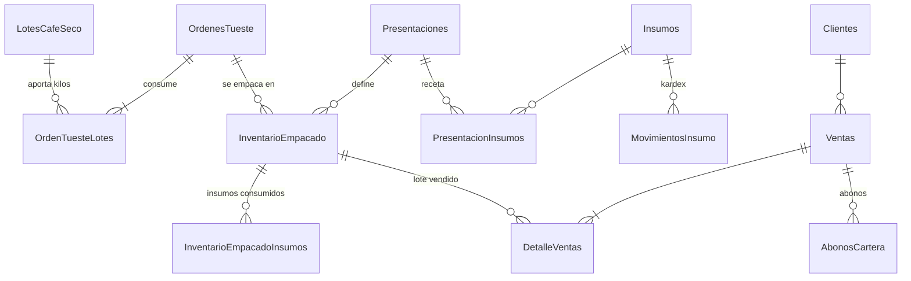

# CaféCostos — Guía técnica

Aplicación de escritorio Windows (monousuario) para tostadores de café: costeo por procesos con absorción de mermas, inventarios por lote con trazabilidad, ventas de contado/crédito y cartera.

---

## 1. Arquitectura de la solución

```
CafeCostos.sln
├── src/
│   ├── CafeCostos.Core     (net8.0, SIN dependencias)  → dominio y matemática de costos
│   ├── CafeCostos.Data     (net8.0, Dapper + SqlClient) → base de datos, transacciones, respaldos
│   └── CafeCostos.App      (net8.0-windows, WPF/MVVM)   → interfaz, impresión, arranque
├── tests/
│   └── CafeCostos.Tests    (xUnit)                      → pruebas del motor de costeo
├── installer/
│   ├── CafeCostos.iss      (Inno Setup)
│   └── (descarga LocalDB y VC++ en el equipo del cliente si faltan)
├── docs/
└── publicar.ps1            (pruebas → publicación → instalador)
```

| Capa | Responsabilidad | Decisiones |
|---|---|---|
| **Core** | Fórmulas de costeo, validaciones, cartera, modelos | Sin acceso a BD ni UI: se prueba de forma aislada. Una sola política de redondeo (`Redondeo`) idéntica a la de SQL Server. |
| **Data** | Servicios por módulo, cada operación de negocio en **una transacción** | **Dapper** en lugar de EF Core: control explícito de `UPDLOCK/ROWLOCK`, SQL con compresión, arranque rápido y ejecutable liviano. |
| **App** | MVVM propio (sin NuGet), vistas XAML, diálogos, impresión FlowDocument | `ContextoApp` es la raíz de composición; los ViewModels no referencian WPF (se pueden probar). |

**Flujo de una operación** (ej. registrar tostión): Vista → `TuesteViewModel.RegistrarAsync` → `TuesteService.RegistrarAsync` (abre transacción, bloquea lotes, llama a `CalculadoraCostos.CalcularTueste`, actualiza inventarios, verifica cuadre) → commit o rollback total.

---

## 2. Modelo de datos



| Tabla | Contenido | Compresión |
|---|---|---|
| `LotesCafeSeco` | Materia prima por lote: kg, costo de compra + flete, existencia y **valor disponible** | PAGE |
| `OrdenesTueste` / `OrdenTuesteLotes` | Tostión (permite mezclas), merma, costos de conversión, inventario de tostado | PAGE |
| `Presentaciones` / `PresentacionInsumos` | 250 g, 500 g… grano/molido, precio y receta de insumos por bolsa | ROW |
| `Insumos` / `MovimientosInsumo` | Bolsas, válvulas, etiquetas con kardex a promedio ponderado | ROW / PAGE |
| `InventarioEmpacado` / `InventarioEmpacadoInsumos` | Lote de producto terminado con desglose de costo | PAGE |
| `Clientes` | Cupo (`NULL` = sin límite, `0` = solo contado) y plazo | ROW |
| `Ventas` / `DetalleVentas` | Comprobante interno; cada línea apunta al **lote empacado** | PAGE |
| `AbonosCartera` | Recibos de caja (anulables) | PAGE |
| `Parametros`, `Consecutivos`, `VersionEsquema` | Configuración, numeración, migraciones | ROW |

Script completo: `src/CafeCostos.Data/Scripts/001_Esquema.sql` (embebido en el ejecutable). Incluye llaves, `CHECK` de integridad (p. ej. `KgTostados < KgSecos`, `Saldo <= Total`), índices compuestos y un **índice filtrado** `IX_Ventas_Cartera … WHERE Estado = 'PENDIENTE'` para que la cartera responda al instante aunque haya años de ventas. Vistas: `vw_CarteraPendiente`, `vw_Trazabilidad`, `vw_EstadoAlmacenamiento`. Procedimiento: `usp_MantenimientoIndices`.

**Migraciones**: cada script `NNN_Descripcion.sql` se aplica una sola vez y queda registrado en `VersionEsquema`. Para evolucionar el esquema basta agregar `002_….sql`.

---

## 3. Matemática del costeo (CafeCostos.Core)

### 3.1 Principio de cuadre exacto
Cada inventario guarda **cantidad disponible** y **valor disponible**. Una salida parcial se valora proporcionalmente (`valor × cantidad / disponible`, redondeado a centavos) y **la salida que agota la existencia se lleva exactamente el saldo**. Resultado: jamás quedan residuos de centavos (`CalculadoraCostos.CostoSalida`).

### 3.2 Tostión — absorción de la merma por evaporación
```
Merma (kg)         = Kg secos − Kg tostados
% Merma            = Merma / Kg secos × 100
Costo total        = Σ costo de lotes secos (+ flete) + energía + mano de obra + otros CIF
Costo kg tostado   = Costo total / Kg tostados          ← la merma queda absorbida
Merma absorbida $  = Costo materia prima × Merma / Kg secos   (informativo)
```
Se advierte (sin bloquear) si la merma sale del rango normal 12 %–22 %.

### 3.3 Molienda, fraccionamiento y empaque — costo de la bolsa
```
Kg netos           = Unidades × gramos / 1000
Merma molienda     = Kg tostado usado − Kg netos   (absorbida; advertencia > 3 %)
Costo café         = CostoSalida(kg tostado usado)
Costo insumos      = Σ (cantidad receta × unidades) × costo promedio ponderado
Costo unitario     = (café + insumos + molienda + mano de obra + otros) / unidades
```

### 3.4 Ejemplo verificado por las pruebas
| Paso | Dato | Resultado |
|---|---|---|
| Compra | 100 kg secos por $2.000.000 | $20.000/kg seco |
| Tostión | 100 → 82 kg; energía $60.000; MO $40.000 | Merma 18 %; costo total $2.100.000; **$25.609,76/kg tostado**; merma absorbida $360.000 |
| Empaque | 100 bolsas de 250 g con 25,5 kg; insumos $1.300/bolsa; conversión $30.000 | Merma molienda 1,961 %; costo café $653.048,78; **costo por bolsa $8.130,49** |

### 3.5 Ventas y cartera
* Costo de venta = `CostoSalida` del lote empacado → utilidad bruta exacta por factura.
* Crédito: valida cliente no genérico, cupo (`saldo actual + nueva venta ≤ cupo`) y calcula vencimiento.
* Abono ≤ saldo; al llegar a cero la factura pasa a `PAGADA`. Edades: por vencer, 1–30, 31–60, 61–90, > 90 días.

### 3.6 Consistencia transaccional
Toda operación que mueve inventario o cartera ocurre en **una** transacción con bloqueo de fila (`UPDLOCK, ROWLOCK`) sobre lo que se va a descontar; los `UPDATE` incluyen la condición de existencia (`WHERE KgDisponibles >= @kg`) y se verifica el número de filas afectadas. Las anulaciones (lote, tostión, empaque, venta, abono) devuelven cantidades **y valores exactos** al origen y solo se permiten si el documento no tiene movimientos posteriores.

---

## 4. Copias de seguridad (RespaldoService)

> ⚠ **Limitación de Microsoft:** `BACKUP DATABASE … WITH COMPRESSION` **no existe en SQL Server Express ni en LocalDB**.

El servicio detecta la edición (`SERVERPROPERTY('EngineEdition')`):

| Edición | Proceso |
|---|---|
| Standard / Enterprise / Developer | `BACKUP DATABASE [CafeCostos] TO DISK=@ruta WITH INIT, FORMAT, CHECKSUM, COMPRESSION` |
| Express / **LocalDB** (la que se instala) | `BACKUP … WITH CHECKSUM` → `RESTORE VERIFYONLY` → empaquetado en `.zip` (Deflate máximo; reducción típica 80–90 %) |

Nombre: `CafeCostos_Respaldo_2026-10-24_221530.zip`. La copia al destino (USB) se hace a un archivo `.parcial`, se verifica el tamaño y luego se renombra: nunca queda un respaldo corrupto con nombre válido.

**Restauración asistida (3 pasos):** (1) elegir archivo → `RESTORE HEADERONLY` valida que sea de CaféCostos y `VERIFYONLY` su integridad; (2) confirmar viendo la fecha de la información; (3) se crea **automáticamente una copia de la información actual**, `SINGLE_USER WITH ROLLBACK IMMEDIATE`, `RESTORE … WITH REPLACE, MOVE`, `MULTI_USER` y se aplican migraciones pendientes.

**Automático al cerrar:** una copia diaria en `…\Automáticas`, conservando las últimas N (parámetro `Respaldo.Conservar`, 15 por defecto).

LocalDB corre con la cuenta del usuario, por eso puede escribir directamente en Documentos o en una USB (con SQL Express como servicio esto fallaría por permisos).

## 5. Mantenimiento automático (MantenimientoService)
Semanal, al cerrar: `usp_MantenimientoIndices` (REORGANIZE 5–30 %, REBUILD > 30 %, conservando la compresión) + `sp_updatestats`; limpieza de temporales; reducción del log solo si supera 256 MB. Nunca se reduce el archivo de datos. Base en modelo `SIMPLE`, `AUTO_CLOSE OFF`, `AUTO_SHRINK OFF`, `PAGE_VERIFY CHECKSUM`, intercalación `Modern_Spanish_CI_AS`.

---

## 6. Compilación, pruebas y empaquetado

**Requisitos del equipo de desarrollo:** Windows 10/11, Visual Studio 2022 (17.8+) con «Desarrollo de escritorio .NET», SDK .NET 8, Inno Setup 6.3+.

```powershell
dotnet test tests\CafeCostos.Tests          # 16 pruebas del motor de costeo
dotnet run --project src\CafeCostos.App     # ejecutar en desarrollo (usa LocalDB del equipo)
.\publicar.ps1                              # pruebas + exe autocontenido + instalador
```

`publicar.ps1` genera `publish\CafeCostos_Instalador_1.0.0.exe`. El ejecutable es **autocontenido** (incluye .NET 8), en un solo archivo, con ReadyToRun para arranque rápido.

### Qué hace el instalador (installer/CafeCostos.iss)
1. Si faltan, descarga de Microsoft e instala Visual C++ 2015-2022 x64 (requisito de LocalDB).
2. Descarga e instala `SqlLocalDB.msi` en silencio (`/qn IACCEPTSQLLOCALDBLICENSETERMS=YES`) si no hay LocalDB 2019/2022.
3. Ejecuta `CafeCostos.exe --inicializar` **como el usuario original** (`runasoriginaluser`), porque las instancias LocalDB son por usuario: crea instancia, base, tablas comprimidas y datos iniciales.
4. Crea accesos directos en Escritorio y menú Inicio.
5. Al desinstalar **no** borra la información ni las copias.

Si la aplicación se instala para otro usuario de Windows, la base se crea sola en su primer arranque (el inicializador es idempotente y también re-adjunta archivos `.mdf` existentes tras una reinstalación).

### Ubicaciones
| Qué | Dónde |
|---|---|
| Programa | `C:\Program Files\CafeCostos\CafeCostos.exe` |
| Base de datos | `%LOCALAPPDATA%\CafeCostos\Datos\CafeCostos.mdf / _log.ldf` |
| Registro de errores | `%LOCALAPPDATA%\CafeCostos\Registros\cafecostos_AAAAMM.log` |
| Copias | `Documentos\CaféCostos Respaldos\` (configurable) |

## 7. Verificación realizada
* Motor de costeo compilado y **16/16 pruebas superadas** (tostión, mezclas, merma anormal, salidas sin residuos, empaque, kg sugeridos, simulador de precio, promedio ponderado, ajustes, ventas, crédito/cupo, consolidación de líneas, edades y abonos).
* Capa de datos y ViewModels verificados por compilación de tipos; script SQL verificado en su división por lotes `GO` y carga como recurso embebido.
* Vistas XAML: verificadas como XML válido, recursos y rutas de enlace contra las propiedades de cada ViewModel.
* Pendiente en Windows: primera compilación WPF en Visual Studio y prueba de humo del instalador en un equipo limpio (ver lista en README).
